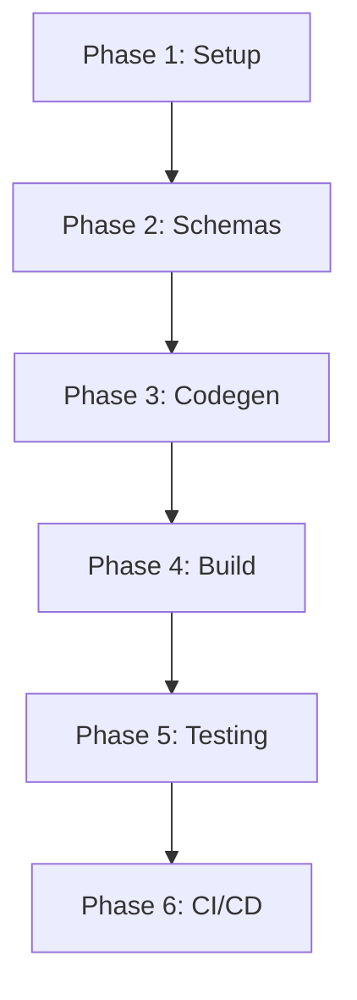

# Shopify API Types - Phase Tracking Overview

## Project Goal
Create an npm package `@juanpprieto/shopify-api-types` that provides TypeScript types and JSON schemas for Shopify's GraphQL APIs (Storefront, Customer Account, and Admin) for the last 4 API versions.

## Phase Status

| Phase | Status | Priority | Description |
|-------|--------|----------|-------------|
| [Phase 1](./001_Phase_1_Project_Setup.md) | 🟡 Not Started | High | Project Setup with Strict TypeScript/Prettier |
| [Phase 2](./002_Phase_2_Schema_Fetching.md) | 🟡 Not Started | High | Schema Fetching and Version Management |
| [Phase 3](./003_Phase_3_Code_Generation.md) | 🟡 Not Started | High | Code Generation Pipeline |
| [Phase 4](./004_Phase_4_Build_System.md) | 🟡 Not Started | High | Build System and Export Configuration |
| [Phase 5](./005_Phase_5_Testing.md) | 🟡 Not Started | Medium | Testing and Validation |
| [Phase 6](./006_Phase_6_CICD_Publishing.md) | 🟡 Not Started | High | CI/CD and NPM Publishing |

## Phase Dependencies



## Quick Start for New Agents

1. **Read the project brief**: `decisions/001_PROJECT_BRIEF.md`
2. **Check current phase**: Look at the status table above
3. **Start with the next incomplete phase**: Each phase has detailed milestones
4. **Update status**: Mark milestones as completed as you progress

## Important Notes

- **Sequential Execution**: Phases must be completed in order due to dependencies
- **Milestone Tracking**: Each phase document contains checkboxes for tracking progress
- **Validation Steps**: Each milestone includes validation criteria
- **Common Issues**: Each phase documents known issues and solutions
- **Agent Handoff**: All critical information is documented for smooth transitions

## Key Technical Decisions

1. **Single Package Structure**: Not a monorepo, traditional single package
2. **API Support**: Storefront, Customer Account, and Admin APIs
3. **Version Support**: Last 4 quarterly releases (01, 04, 07, 10)
4. **Build System**: Vite with ESM and CommonJS output
5. **Type Generation**: GraphQL Codegen from introspection schemas
6. **Publishing**: Changesets for version management, GitHub Actions for CI/CD
7. **Code Quality**: Strictest TypeScript configuration with all checks enabled
8. **Formatting**: Strictest Prettier configuration for consistent code style
9. **Linting**: ESLint flat config with TypeScript strict rules
10. **Git Hooks**: Husky with lint-staged for pre-commit quality checks

## Environment Requirements

- Node.js 18+ (for development)
- NPM account with publishing rights
- Shopify API tokens for schema fetching:
  - `SHOPIFY_STOREFRONT_ACCESS_TOKEN`
  - `SHOPIFY_CUSTOMER_ACCOUNT_ACCESS_TOKEN`
  - `SHOPIFY_ADMIN_ACCESS_TOKEN`

## Expected Package Usage

```typescript
// Import types from specific versions
import type { Product } from '@juanpprieto/shopify-api-types/sfapi/2025-01';
import type { Customer } from '@juanpprieto/shopify-api-types/caapi/2025-01';
import type { Order } from '@juanpprieto/shopify-api-types/admin/2024-10';

// Import schemas for validation
import { schema } from '@juanpprieto/shopify-api-types/sfapi/2025-01';
```

## Repository Structure (When Complete)

```
shopify-api-types/
├── src/
│   ├── storefront/
│   │   ├── 2025-01/
│   │   ├── 2024-10/
│   │   ├── 2024-07/
│   │   └── 2024-04/
│   ├── customer-account/
│   │   └── [versions]/
│   ├── admin/
│   │   └── [versions]/
│   └── schemas/
│       └── [api]/[version].json
├── dist/
│   └── [built files]
├── scripts/
│   ├── version-utils.ts
│   ├── fetch-schemas.ts
│   ├── generate-indexes.ts
│   └── [other scripts]
├── tests/
│   └── [test files]
├── .github/
│   └── workflows/
│       ├── ci.yml
│       └── release.yml
└── [config files]
```

## Success Metrics

- ✅ All 6 phases completed
- ✅ Package published to NPM
- ✅ Types generate without errors
- ✅ All tests passing
- ✅ CI/CD pipeline operational
- ✅ Documentation complete

## Getting Help

- Each phase document contains troubleshooting sections
- Check for existing issues in phase documents
- Reference the technical plan: `decisions/002_TECHNICAL_PLAN.md`
- Shopify API documentation: https://shopify.dev/docs/api